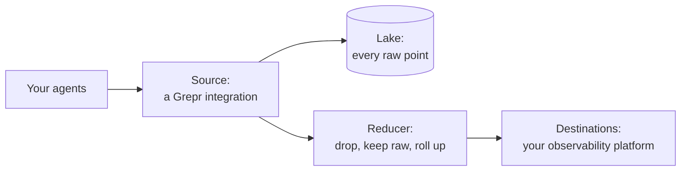

import { Callout } from 'nextra/components'
import { HiddenFAQ } from '@/components/HiddenFAQ'

# Reduce metrics with a metrics pipeline

<Callout type="info">
  Metrics pipelines are in a closed beta. To request access, contact [support@grepr.ai](mailto:support@grepr.ai).
</Callout>

A _metrics pipeline_ reduces the number of metric points that your agents send to your observability platform. Your agents send their metrics to a Grepr integration instead of to the platform. The pipeline drops the metrics you don't need, rolls the rest up to one point per time window, and can combine the series of many hosts or containers into one series per group, such as one series per environment. It then sends the reduced metrics to your platform. Optionally, the pipeline also keeps every raw point it receives in a Grepr data lake, where you can explore and query the full-resolution data.

This page describes how a metrics pipeline works, how to create one in the Grepr UI, how to monitor and change it, and how to configure it with the Grepr API or Terraform. Each supported vendor has its own section, which describes how to send its agents' metrics to Grepr and how the pipeline works with its source and destinations. To learn how to choose what the pipeline does with each metric, see [_](/pipelines/metrics-pipelines/reducer).

## How a metrics pipeline reduces metrics [#how-it-works]

An agent reports each metric as one or more _series_. A series is a metric name together with its tags, such as `system.cpu.user` with `host:web-1` and `env:prod`. The agent sends a new _point_ for each series at its _report interval_, such as every 15 seconds.

Some agents also report the tags of the host they run on, such as the host's environment, apart from the host's series. The source attaches these _host tags_ to each of the host's series. When a series and its host both have a tag with the same key, the series' own tag applies.

A metrics pipeline has four parts:

- The _source_ is the integration that your agents send metrics to.
- The optional _lake_ is a dataset that keeps every raw point from the source, before any reduction.
- The _reducer_ decides what happens to each series. It drops some metrics, sends some as they arrive, and rolls the others up. A _time rollup_ sends one point per series per window, such as one point per minute instead of four. An _across-objects rollup_ combines the series of many hosts, containers, or pods into one series per group, such as one series per environment.
- The _destinations_ are the integrations that receive the reduced metrics.



## Supported sources and destinations [#supported-integrations]

A metrics pipeline reads metrics from one source integration, and sends the reduced metrics to its destinations. The following table lists the supported vendors. Each vendor's section on this page describes how to set up its agents, and how the pipeline works with its source and destinations.

| Vendor | Source | Destinations |
|---|---|---|
| [Datadog](#datadog) | Datadog Agents, through a Grepr Datadog integration | Datadog, through the source's integration |

## Create a metrics pipeline [#create-pipeline]

### Step 1: Send your agents' metrics to Grepr

Create a Grepr integration for your vendor, and configure your agents to send their metrics to the integration. To set up your vendor's agents, see the vendor's section on this page, listed in [_](#supported-integrations).

### Step 2: Create the pipeline

To create the pipeline, on the **Pipelines** page, click **Create Pipeline**, select **Metrics Pipeline** as the pipeline type, enter a name, and click **Create**.


### Step 3: Choose the source [#source]

Click **Source** in the left pane and select the integration that your agents send metrics to.

The following settings of the source are optional:

- **Identifying keys** are the tags that tell series apart, in addition to the tags each series carries. A host tag that's listed here becomes part of the identity of each of the host's series, so series that differ in its value stay apart, such as in an **Across objects** rollup, and a change in its value starts a new series. Enter exact keys or globs with `*`. The default depends on the source's vendor. The reducer's **Group By** and **Objects** keys are always identifying, so you don't need to list them here. To learn more about these keys, see [_](/pipelines/metrics-pipelines/reducer#across-objects).
- **Rename metrics** renames a metric before any other step of the pipeline reads it, so the reducer, the lake, and the destinations all see the new name. Each rename has a metric name and a new name. A plain metric name matches exactly. A name that starts with `r/` is an [RE2 regular expression](https://github.com/google/re2/wiki/Syntax) that matches the whole metric name, and the new name can insert its groups with `$1` or `${name}`. For example, `r/app\.(web|api)\.count` renamed to `app.$1.total` renames `app.web.count` to `app.web.total` and `app.api.count` to `app.api.total`. A metric takes the first rename that matches it. Saving a change to the renames restarts the pipeline.

Below these settings, the source shows the settings of its vendor. To learn about them, see the vendor's section on this page.

### Step 4: Keep raw points in the data lake [#lake]

To keep every raw point that the source accepts, click **Lake** in the left pane and select a dataset. The lake stores each point before the reducer processes it, including the points of metrics that the reducer drops, and with your renames applied. The source doesn't accept malformed points, points stamped more than 10 minutes after the source receives them, or the other points that its vendor's section names. For each point of a distribution metric, the lake keeps the number of values the point summarizes, their sum, average, minimum, and maximum. Under **Distribution storage**, choose what else it keeps: nothing, the point's p50, p90, p95, and p99, or its distribution as a t-digest, which you can cap under **T-digest cap**. A lake you add starts on the percentiles. See [Store distribution metrics in less space](/grepr-platform/data-lake#distribution-sketch-cap). To store chosen metrics another way, add overrides by metric name under **Storage by metric**. See [Store chosen metrics another way](/grepr-platform/data-lake#storage-by-metric). To keep no lake, select **None**. To learn more about the Grepr data lake, see [_](/grepr-platform/data-lake).

### Step 5: Configure the reducer [#reducer]

Click **Reducer** in the left pane to choose what the pipeline does with each metric. A new pipeline rolls up every metric in time, to one point per series per minute. To drop metrics, keep some raw, or combine series across hosts or containers, see [_](/pipelines/metrics-pipelines/reducer).

### Step 6: Choose the destinations [#destinations]

Click **Destinations** in the left pane and select the integration that receives the reduced metrics. Which integrations can be destinations depends on the source's vendor, as the vendor's section on this page describes.

### Step 7: Create the pipeline

Click **Create Pipeline**. Grepr deploys the pipeline, and the pipeline starts reading the metrics that your agents send to the source integration.

## Monitor a metrics pipeline [#monitor]

The pipeline's **Overview** step shows how the pipeline handles your metrics over the selected time range:

- **Source** shows the rate of points in, and the share of points dropped before the reducer, such as malformed points.
- **Lake**, when the pipeline has one, shows the rate of points the lake stores.
- **Reducer** shows the reduction, as how many times fewer points the pipeline sends than it receives. It also shows what the reducer does with each point: aggregated, passed through, dropped, or late. It shows the number of active series, how far behind real time the pipeline runs, how many objects have series that the reducer sends per object, and how many appear only in across-objects rollups.
- **Destinations** shows the rate of points out, and the share of them that are aggregated, passed through, or re-sent for late points. A destination's vendor can add its own counts. To learn about them, see the vendor's section on this page.

The **Reducer** step shows the same reduction for the selected time range, above the board.

## Explore and query the raw points [#query]

When the pipeline keeps raw points in a lake, you can read them at full resolution:

- To aggregate and chart a dataset's metrics, or explore the series it holds, use Metrics Explorer. See [_](/queries/metrics-explorer).
- To query the points or their series with SQL, add a **Metric points** or **Metric series** table on the SQL page. See [_](/queries/sql).
- To send raw points from the lake to your observability platform, backfill them from Metrics Explorer. See [_](/queries/metrics-explorer#backfill).

## Change a running pipeline [#change-pipeline]

To change a pipeline, edit its steps and click **Apply Changes**.

A change to the reducer's cards, its window, or its per-metric functions over time applies to the running pipeline without a restart, when the pipeline has no **Across objects** card and no anomaly rules, both before and after the change. Some of the source's vendor settings also apply without a restart, as the vendor's section on this page describes, and so do the lake's **Distribution storage**, **T-digest cap**, and **Storage by metric**. Any other change restarts the pipeline.

## How a metrics pipeline handles late points [#late-points]

The reducer sends each rolled-up window 15 seconds after the window ends, by default. A point that arrives after its window was sent is _late_. The reducer holds each rolled-up window for the longer of 30 seconds and ten windows after it ends, so with one-minute windows, it holds each window for ten minutes:

- A late point that arrives while the reducer holds its window updates the window, and the reducer sends the update at most every 15 seconds by default. For a count, rate, or gauge, the update is the window's whole value. For a distribution, the update holds only the late points.
- A point that arrives after its window's hold ends isn't sent to your destinations. If the pipeline has a lake, the lake still keeps it.

A metric that a **Keep raw** card or **Pass through** takes has no window: the reducer sends each of its points when the point arrives. The reducer doesn't send a raw point more than 1 hour behind the pipeline's progress through your metrics, and raising a destination's limit doesn't change this. If the pipeline has a lake, the lake still keeps the point.

Each destination also has a limit on how old a point it still sends, measured when the point goes out, so the limit matters when the pipeline runs behind real time. The limit depends on the destination's vendor, and it also limits the window, because the reducer's last update of a window must go out within it. To learn about a vendor's limit and how to raise it, see the vendor's section on this page.

The **Overview** step shows the share of late points.

## Configure a metrics pipeline with the API or Terraform [#api]

A metrics pipeline is a pipeline whose job graph has one vertex: a template operation of the built-in `metrics-reducer-job-graph-template` template. The vertex's `templateInputs.input` holds the pipeline's settings. To use the same settings with the Grepr API or the [Grepr Terraform provider](/admin/terraform-provider), create the pipeline in the Grepr UI first, then copy its job graph JSON: click **Jobs** in the menu bar, click the three-dot menu in the **Actions** column for your pipeline, and click **Edit JSON**.

The following example shows a pipeline that keeps raw points in a dataset, drops one metric family, and rolls up every other metric to one point per minute:

```json copy
{
  "vertices": [
    {
      "type": "template-operation",
      "name": "template_operation",
      "templateId": "<metrics-template-id>",
      "templateInputs": {
        "input": {
          "source": {
            "integrationId": "<your-integration-id>",
            "integrationType": "<your-integration-type>"
          },
          "sinks": [
            {
              "integrationId": "<your-integration-id>",
              "integrationType": "<your-integration-type>"
            }
          ],
          "datasetId": "<your-dataset-id>",
          "sketchMode": "PERCENTILES",
          "granularity": "PT1M",
          "dropRules": [
            { "metricName": { "includes": ["app.debug.*"] } }
          ],
          "rules": [
            {
              "type": "time-rollup",
              "name": "every-metric",
              "selectors": { "metricName": { "includes": ["*"] } }
            }
          ]
        }
      }
    }
  ],
  "edges": []
}
```

- `<metrics-template-id>` is the ID of the built-in template named `metrics-reducer-job-graph-template`. To find it, [list your templates](/templates#list-templates).
- `<your-integration-id>` is the ID of the source's integration, `<your-integration-type>` is its vendor's type, such as `datadog`, and `<your-dataset-id>` is the ID of the lake's dataset. If you copied the JSON from an existing pipeline, these fields are already set.
- `sketchMode` sets what the lake keeps of each distribution point, as the Lake step's **Distribution storage** does. The example keeps percentiles, which a lake added in the editor starts on. Without it, the lake stores t-digests. See [Store distribution metrics in less space](/grepr-platform/data-lake#distribution-sketch-cap).
- `sketchOverrides`, which the example leaves out, stores chosen metrics another way, as the Lake step's **Storage by metric** does. See [Store chosen metrics another way](/grepr-platform/data-lake#storage-by-metric).
- Keep the vertex's `name` when you edit the pipeline. Grepr keeps the pipeline's open windows and its progress through your metrics under that name.
- Each rule has a `name` that's unique among the rules, made of letters, digits, `_`, and `-`, up to 64 characters. Keep a rule's name when you edit the rule: a `group-by` rule keeps its open windows under its name, so renaming a rule is the same as removing it and adding another.

Each card on the Reducer step is an entry in `dropRules` or a rule in `rules`, in column order, and **Everything else** set to **Roll up in time** is the last rule, a `time-rollup` rule of `*`. A rule's `type` is `passthrough` for **Keep raw**, `time-rollup` for **Roll up in time**, or `group-by` for **Across objects**.

To set how old a point a destination still sends, measured when the point goes out, set the sink's `maxLateData`, such as `"PT6H"`. Each vendor's destinations have their own default and minimum, and the value must be at least eleven of the pipeline's longest windows plus 5 minutes, so a longer window needs a longer limit. The reducer holds late points for at most 2 hours, so a window is at most 12 minutes long whatever the limit. A pipeline whose windows don't fit is refused when it's saved. To send each window sooner after it ends, set `lateMetrics.softLateDeadline`, such as `"PT5S"`. It must be longer than zero and shorter than 30 seconds, and it also sets how often the reducer re-sends a window that late points change. For every field, see the [`MetricsReducerTemplateInput` schema](/apis/api-spec#schema/MetricsReducerTemplateInput).

## Datadog [#datadog]

A metrics pipeline reads the metrics that Datadog Agents send to a Grepr Datadog integration, and sends the reduced metrics to Datadog through the same integration.

### Send Datadog Agent metrics to the pipeline [#datadog-agent]

Create a Datadog integration, and configure your Datadog Agents to send their metrics to the integration's ingest URL. See [_](/integrations/datadog#send-metrics).

The pipeline reads metric series from the agent's v2 series API, and the agent's distribution metrics. For how Grepr sends the Datadog Agent's distribution metrics and service checks to Datadog, see [_](/integrations/datadog#distribution-metrics) and [_](/integrations/datadog#checks-and-events).

A Datadog Agent reports each series every 15 seconds by default. The reducer's estimates of each card's reduction use this report interval. For **Across objects** cards, use a window of 15 seconds or longer. See [_](/pipelines/metrics-pipelines/reducer#across-objects).

A Datadog source also doesn't accept the copies of a payload that an agent sends again within an hour, or the points of a new host while the source waits for the host's metadata.

### Distribution metrics in Datadog [#datadog-distributions]

The Datadog Agent sends its distribution metrics as sketches. A rollup card merges the sketches of each window into one sketch, which goes out under the metric's own name, whatever the card's functions and the metric's per-metric settings. An **Across objects** card merges the sketches of a group's objects in the same way. A **Keep raw** card or **Pass through** sends each sketch as it arrives.

A merged sketch keeps every bin of the sketches it merges, up to 4,096 bins, the most that a Datadog Agent's sketch holds. Within that bound, the count and the percentiles that Datadog computes from a merged sketch equal those of the raw sketches. Values that span more bins, about 27 orders of magnitude, have their lowest bins combined, which can raise the lowest percentiles. Either way, the count, minimum, and maximum match the raw sketches', and the sum and average match theirs to rounding.

If your Datadog contract uses Metric Name pricing, Datadog multiplies a distribution's datapoint volume by five, or by ten when the metric's percentile aggregations are turned on. Tag configuration and indexing rules can reduce the indexed volume. See [Metric Name pricing](https://docs.datadoghq.com/account_management/billing/metric_name_pricing/) in the Datadog documentation. A window that late points update sends one more sketch for each update, and a sketch too large for one Datadog request goes out in parts, each of which counts as a point. See [_](#datadog-late).

If an agent also sends its distribution metrics to Datadog directly, as with dual shipping, Datadog counts and bills them twice. See [_](/integrations/datadog#distribution-metrics).

### Host tags and host metadata [#datadog-host-tags]

A Datadog Agent reports its host's tags, such as `env` or `kube_node`, in the host's metadata rather than on each series, and the source attaches them to each of the host's series as host tags. The default identifying key of a Datadog source is `env`.

For each host whose own series the pipeline sends, a Datadog destination also receives the host's metadata, so Datadog shows the host and its tags as the agent reported them. When none of a host's series reaches Datadog as the host's own, because the pipeline drops them or combines them across hosts, Datadog doesn't receive the host's metadata.

### Wait for a new host's metadata [#datadog-host-wait]

On the **Source** step, **Wait for a new host's metadata** sets how long the pipeline waits for a new host's Datadog Agent to send the host's metadata, which carries the host's tags. Until the metadata arrives, or until the wait ends, the pipeline drops the host's points, so neither Datadog nor the lake receives them. After the wait, the pipeline processes the host's points without its host tags until the metadata arrives. A new agent sends its metadata when it starts, and the default wait is 10 minutes. To process a new host's points immediately, select **Don't wait**. Until the metadata arrives, filters and rules on a host tag don't match those points.


A saved change to this setting applies within 20 seconds, without a restart. On the **Overview** step, **Source** counts the points dropped while their host waits for its metadata.

### Across-objects rollups in Datadog [#datadog-cohorts]

When `host` is an **Objects** key of the reducer, as it is by default, Grepr also sends Datadog a virtual host for each group, named for the group, such as `cohort_env-prod_<hash>`. The combined series appear under that host in Datadog. To learn how the reducer names a group, see [_](/pipelines/metrics-pipelines/reducer#across-objects).

### Monitor a Datadog pipeline [#datadog-monitor]

On the **Overview** step, **Destinations** shows the hosts Datadog received in the last 10 minutes: your hosts, which have their own series, and the virtual hosts that carry across-objects rollups. Datadog counts both as hosts.


### Late points in Datadog [#datadog-late]

For a count, rate, or gauge, Datadog keeps the last value it receives for a series and timestamp, so a window's update replaces its earlier value. For a distribution, Datadog adds each sketch it receives to the window's earlier sketches. Either way, a window in Datadog holds every point that reached the reducer before the window's hold ended.

A Datadog destination doesn't send a point more than 55 minutes old when the point goes out, because Datadog accepts points up to 1 hour old only. With this limit, a window is at most 4 minutes long. If your metrics have Datadog's historical metrics ingestion turned on, you can raise the limit with the sink's `maxLateData`. A longer limit allows windows of up to 12 minutes, and lets a pipeline that runs more than 55 minutes behind real time still send its points. The default and minimum of a Datadog sink's `maxLateData` is 55 minutes. See [_](#api).

### Datadog limitations [#datadog-limits]

- A Datadog source reads metrics from Datadog Agents only.
- A Datadog destination must be the source's own Datadog integration.

## Limitations [#limitations]

- A metrics pipeline reads metrics from one source integration, of a supported vendor. See [_](#supported-integrations).
- A window is at most 12 minutes long, and each destination's limit on how old a point it sends can shorten it. See [_](/pipelines/metrics-pipelines/reducer#window).

<HiddenFAQ
  faqs={[
    {
      q: "What is a Grepr metrics pipeline?",
      a: "A metrics pipeline reduces the number of metric points your agents send to your observability platform. The agents send their metrics to a Grepr integration, and the pipeline drops the metrics you don't need, rolls the rest up to one point per time window, and can combine the series of many hosts or containers into one series per group before sending the metrics to your platform."
    },
    {
      q: "Can a metrics pipeline keep my raw metrics?",
      a: "Yes. When you select a dataset on the pipeline's Lake step, the pipeline keeps every raw point that it receives in the Grepr data lake, before any reduction, including the points of metrics that the reducer drops. You can explore the points from the Metrics menu, or query them with SQL."
    },
    {
      q: "Which sources and destinations do metrics pipelines support?",
      a: "Metrics pipelines support Datadog. A metrics pipeline reads the metrics that Datadog Agents send to a Grepr Datadog integration, and sends the reduced metrics to Datadog through the same integration."
    },
    {
      q: "What happens to metric points that arrive late?",
      a: "The reducer holds each rolled-up window for the longer of 30 seconds and ten windows after it ends. A late point that arrives during the hold updates its window, and the reducer sends the update: the window's whole value for a count, rate, or gauge, and only the late points for a distribution. A point that arrives after the hold isn't sent to your destinations. If the pipeline has a lake, the lake still keeps it."
    },
    {
      q: "Does changing a metrics pipeline restart it?",
      a: "A change to the reducer's cards, window, or per-metric functions over time applies without a restart when the pipeline has no Across objects card and no anomaly rules, both before and after the change. Some of the source's vendor settings, and the lake's distribution storage, t-digest cap, and overrides by metric, also apply without a restart. Any other change restarts the pipeline."
    }
  ]}
/>
