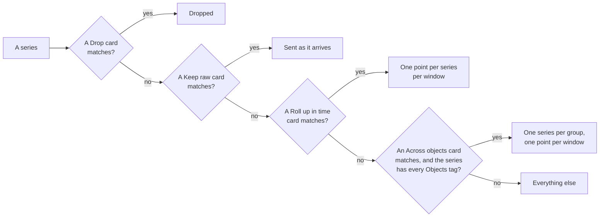

import { Callout } from 'nextra/components'
import { HiddenFAQ } from '@/components/HiddenFAQ'

# Configure the metrics reducer

<Callout type="info">
  Metrics pipelines are in a closed beta. To request access, contact [support@grepr.ai](mailto:support@grepr.ai).
</Callout>

The reducer of a [metrics pipeline](/pipelines/metrics-pipelines) decides what the pipeline sends for each metric. You configure it on the pipeline's **Reducer** step, which shows the reducer as a board. Each column of the board is one outcome, and each card in a column names the metrics that get that outcome:

- **Drop** removes the metrics. The pipeline doesn't send them.
- **Keep raw** sends every point as it arrives, with each series' own tags.
- **Roll up in time** keeps each series on its own and sends one point per series per window.
- **Across objects** combines the series of many objects, such as hosts or containers, into one series per group, such as one series per environment, and sends one point per window.
- **Everything else**, below the columns, is what happens to every metric that no card takes.

## How the reducer chooses a card [#order]

A metric goes to the first card that matches it, reading the columns from left to right and the cards in each column from top to bottom: Drop, then Keep raw, then Roll up in time, then Across objects, then Everything else. The order of the columns is fixed.

To make an exception to a card, put the exception in an earlier column, or add the metrics it leaves out to the card's **Except** field. For example:

| To | Add |
|---|---|
| Keep specific metrics raw and roll up the rest | A **Keep raw** card with the metrics, and **Everything else** set to **Roll up in time** |
| Drop a metric family except one subfamily | A **Drop** card with `kubernetes.*` and `kubernetes.pods.*` under **Except** |
| Keep per-host detail for a subfamily of an across-objects family | A **Roll up in time** card with `kubernetes.node.*`, and an **Across objects** card with `kubernetes.*` |
| Combine a subfamily across objects within a per-host family | A **Roll up in time** card with `kubernetes.*` and `kubernetes.pods.*` under **Except**, and an **Across objects** card with `kubernetes.pods.*` |

A card whose **Metrics** field holds only `*`, `r/.*`, or `r/.+`, with no **Except** and no **Tags**, takes every metric. When such a card is in the **Drop**, **Keep raw**, or **Roll up in time** column, nothing after it applies, so you can't add cards to its column or a later one, or change **Everything else**. An **Across objects** card that takes every metric still leaves the series that are missing an **Objects** tag to **Everything else**.

To add a card, click **Add metrics** in its column. To reorder a card, move it to another column, or delete it, use the card's menu.

## Choose the metrics a card takes [#card-metrics]

A card takes a series when the series matches every field that the card sets:

- **Metrics** lists the metric names the card takes.
- **Except** lists the metric names the card leaves out, even when **Metrics** matches them.
- **Tags** lists `key:value` conditions, such as `env:prod`. A series must match every condition. A condition reads the series' own tag, and then its host tag. To learn more about host tags, see [_](/pipelines/metrics-pipelines#how-it-works).

A card must set at least one of these fields. To take every metric, enter `*` in **Metrics**.

A metric name or a tag value can be a glob or a regular expression:

- A glob matches the whole name or value, and `*` matches any characters, such as `kubernetes.*` or `*.count`.
- A pattern that starts with `r/` is an [RE2 regular expression](https://github.com/google/re2/wiki/Syntax) that matches the whole name or value. For example, `r/app\.(web|api)\..+` takes `app.web.requests` and `app.api.requests`, but not `app.db.queries`. To match a value that starts with `r/`, such as `r/abc`, write it as the regular expression `r/r/abc`.

A tag key in **Tags** can't be a regular expression.

## Drop metrics [#drop]

A metric that a **Drop** card takes isn't sent to your destinations. The **Drop** column comes before every other card, so a metric that a **Drop** card takes never reaches a later card.

If the pipeline has a lake, the lake still keeps the points of dropped metrics, because the lake stores each point before the reducer.

## Keep metrics raw [#keep-raw]

A metric that a **Keep raw** card takes is sent as it arrives, one time, with each series' own tags. A **Keep raw** card comes before the rollup columns, so use it to make an exception to a rollup.

## Roll up metrics in time [#time-rollup]

A metric that a **Roll up in time** card takes keeps each series on its own, and the reducer sends one point per series per window. By default, the point is the sum of the window's points for a count, the average for a rate, and the latest value for a gauge. A distribution's points merge into one distribution per window. To send other values of a count, rate, or gauge, see [_](#functions).

A time rollup also takes a series that is missing an **Objects** tag, and rolls it up as itself.

## Combine metrics across objects [#across-objects]

A metric that an **Across objects** card takes is combined across _objects_, such as hosts or containers, within each _group_, such as each environment. Series that differ only in their **Objects** tags become one series, and the reducer sends one point per window for it. Series that differ in another of their own tags, or in a host tag listed in the source's **Identifying keys**, stay separate. Other host tags don't keep series apart: the combined series carries such a tag only when every series combined in the window has the same value for it when the reducer first sends the window. A re-sent window keeps the tags of its first send.

The **Across objects** column's settings apply to every card in the column:

- **Objects** lists the tag keys that identify one object, such as `host` or `container_id`. The default is `host`. A series must have every **Objects** tag to be combined, so each key you add narrows what the column takes. For example, with `host` and `container_id`, the column combines the series of containers, and host-level series, which have no `container_id` tag, go on to the next card or to **Everything else**. Below the field, the column suggests common keys of your source's vendor.
- **Group By** lists the tag keys whose values the reducer keeps apart, such as `env`. The default is `env`. With no keys, every object is in one group. A key can't be both an **Objects** key and a **Group By** key.

The reducer first rolls up each object's series over the window, with the metric's default function over time, and then combines the objects of a group. By default, it combines them with the sum for a count and the average for a rate or a gauge, and it merges the distributions of a distribution metric. A card's functions choose how the reducer combines the objects' counts, rates, and gauges. To send other values, see [_](#functions).

Each combined series reaches your destinations with each **Objects** tag set to the group's name, and carries the group's name as its `grepr.cohort` tag. The group's name is `cohort_` followed by the group's tags and a 6-character hash of them, such as `cohort_env-prod_<hash>`, so with the default settings a combined series has a tag such as `host:cohort_env-prod_<hash>`. The hash tells apart groups whose tags read alike, and a long name is shortened before its hash. When **Group By** has no keys, the name is `cohort-default`, and for series that have none of the **Group By** tags, the name is `cohort`. For how a vendor's destination shows the combined series, see the vendor's section of [_](/pipelines/metrics-pipelines#supported-integrations).

An **Across objects** card takes only the series that have every **Objects** tag. A series that is missing one, such as a series with no `container_id` tag when `container_id` is an **Objects** key, goes on to the next card that matches it, or to **Everything else**.

A window shorter than your agents' report interval holds only the objects that reported during it. For **Across objects** cards, use a window at least as long as the report interval, or a combined value can change from one window to the next as objects report. For the report interval of a vendor's agents, see the vendor's section of [_](/pipelines/metrics-pipelines#supported-integrations).

## Choose what happens to everything else [#everything-else]

**Everything else** handles every metric that no card takes, including the series that an **Across objects** card can't take because they're missing an **Objects** tag. Select one of the following:

- **Roll up in time** rolls up each series over the window, as a **Roll up in time** card does. A new pipeline starts with this setting.
- **Pass through** sends the metrics as they arrive.

## Set the window [#window]

The window is the time that each rolled-up point covers. To set the window for every card, select it in **Roll up to (every rule)**, from 1 second to 2 minutes. A new pipeline starts with 1 minute, and **Default** is 20 seconds.

To give one rollup card its own window, click **Own window…** in the card's menu. The card shows its own window as a chip. To return the card to the window of every card, delete the chip.

With the API, a window must divide an hour evenly and be at most 12 minutes, and each destination must still send the window's last re-send, which comes up to eleven windows plus 5 minutes after the window starts. A pipeline with a window longer than a destination's limit allows is refused when it's saved. To use a longer window, raise the destination's `maxLateData` to at least eleven windows plus 5 minutes. See [_](/pipelines/metrics-pipelines#api). For a vendor's default limit, and what raising it needs, see the vendor's section of [_](/pipelines/metrics-pipelines#supported-integrations).

## Choose a card's functions [#functions]

By default, a rollup card sends one point per window, using each metric's default function. To send other values of a count, rate, or gauge, or more than one value, click **Functions…** in the card's menu and add a function for each value to send:

- **Function** is **Default**, **Sum**, **Average**, **Latest**, **Max**, **Min**, or **Percentile**. **Default** is the metric's per-metric function, if you set one, and otherwise its type's default. **Percentile** takes a **Rank** from 0 to 1, such as `0.99`.
- **Suffix** names the function's output metric: the metric's name, a dot, and the suffix, such as `system.cpu.user.p99` for the suffix `p99`. At most one function of a card can have no suffix, and that function's output keeps the metric's name. Each suffix of a card is distinct.

Each function sends its own series. A **Roll up in time** card with three functions sends three points per window for each series it takes, and an **Across objects** card with three functions sends three points per window for each combined series.

A card's functions apply to counts, rates, and gauges. A distribution metric goes out merged under its own name, whatever the card's functions. For how a vendor's distributions merge, see the vendor's section of [_](/pipelines/metrics-pipelines#supported-integrations).

On an **Across objects** card, the functions choose how the reducer combines a group's objects. Each object's series is first rolled up over the window with the metric's default function over time, so a **Max** of a gauge is the maximum of the objects' latest values in the window.

## Set a metric's default functions [#per-metric]

To change the default function of one count, rate, or gauge metric for every card, under **Per-metric settings**, click **Add metric**, enter the exact **Metric name**, and select the functions:

- **Over time** is the function that rolls up the metric's points in a window: **Sum**, **Average**, **Latest**, **Min**, or **Max**.
- **Across objects** is the function that combines the objects of a group: **Sum**, **Average**, **Latest**, **Min**, or **Max**.

A **Roll up in time** card uses the **Over time** function where its function is **Default**, and a function that the card names takes precedence. An **Across objects** card always rolls up each object's series with the **Over time** function, and it uses the **Across objects** function where its function is **Default**.

## Check the expected reduction [#reduction]

Each rollup card shows an estimate of its reduction, such as "≈ 4× fewer points, if sources report steadily". The estimate is the card's window divided by the report interval of the source's agents, at least 1, divided by the number of functions the card sends. An **Across objects** card's estimate is per series, before the series it combines.

When the board shows a live time range and has no unsaved changes, a **Keep raw** or rollup card, or **Everything else**, shows **No series matched yet** when no series has reached it since its configuration took effect. Check that your agents send the metrics the card names, that the series match the card's **Tags**, and, for an **Across objects** card, that the series have every **Objects** tag. An earlier card might also take the metrics. To give them to the later card, add them to the earlier card's **Except** field.

The top of the step shows the measured reduction over the page's time range: the points in and out, how many times fewer points the pipeline sends, and the share of late points. To open the pipeline's **Overview** step, click **Overview**. See [_](/pipelines/metrics-pipelines#monitor).

## Edit the reducer in JSON [#json]

To edit the reducer's settings as JSON, click **Edit in JSON** below the board. To learn about the fields, see [_](/pipelines/metrics-pipelines#api).

The board shows rules in its column order only: Keep raw, then Roll up in time, then Across objects. When rules written in JSON are in another order, the step doesn't show the board, and you edit the rules in JSON.

<HiddenFAQ
  faqs={[
    {
      q: "In what order does the metrics reducer apply its cards?",
      a: "A metric goes to the first card that matches it: Drop cards first, then Keep raw, then Roll up in time, then Across objects, from top to bottom within each column, and then Everything else. The order of the columns is fixed."
    },
    {
      q: "Can a metrics reducer card match metric names with a regular expression?",
      a: "Yes. A metric name or tag value that starts with r/ is an RE2 regular expression that matches the whole name or value. Any other pattern is a glob, where * matches any characters."
    },
    {
      q: "What does combining metrics across objects do?",
      a: "An Across objects card combines the series of many objects, such as hosts or containers, into one series per group, such as one per environment. Series that differ only in their Objects tags become one series, which carries its group's name, such as cohort_env-prod followed by a hash, in each Objects tag."
    },
    {
      q: "What happens to a series that is missing an Objects tag?",
      a: "An Across objects card takes only the series that have every Objects tag. A series that is missing one goes on to the next card that matches it, or to Everything else. A Roll up in time card rolls it up as itself."
    },
    {
      q: "Can a card send a percentile or more than one value?",
      a: "Yes, for counts, rates, and gauges. A rollup card's Functions menu adds Sum, Average, Latest, Max, Min, or Percentile functions, each with its own suffix. Each function sends its own series. A distribution metric goes out merged under its own name, whatever the functions."
    }
  ]}
/>
