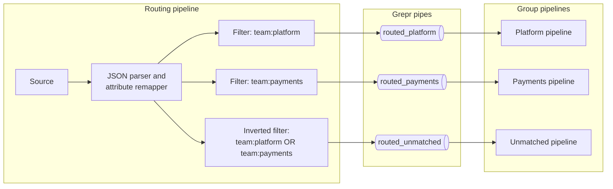

import { HiddenFAQ } from '@/components/HiddenFAQ'

# Route logs to separate pipelines

Your logs arrive at one source, and one team owns how they come in. Other teams own their share of the logs and want to process it their own way, with their own reduction settings, exceptions, datasets, and vendor accounts, without access to anyone else's logs.

A _Grepr pipe_ is an integration that carries log events from one pipeline to other pipelines in the same organization. A pipeline writes into a pipe with a pipe sink, and another pipeline reads from it with a pipe source. A pipe carries each log event as Grepr parsed it, with its tags, attributes, and timestamps unchanged, and the event doesn't pass through the ingestion service again. Pipes carry logs only.

With pipes, the owning team runs one routing pipeline that reads all your logs, parses them, and writes each group's logs into that group's pipe, based on a routing key. Each team runs its own pipeline that reads its group's pipe and does everything else: reduction, writing raw logs to the data lake, and sending to the team's vendor account. In this guide, the team that runs the routing pipeline is the _routing team_.

Because each group has its own pipeline, a slow vendor account delays only its own group's logs. If every group shares one configuration, a single pipeline with a filtered sink for each account is simpler and runs fewer pipelines. See [_](/solution-guides/route-logs-to-several-accounts).

Before you start, you need a Grepr team for the routing team and for each group's team, a Grepr integration for each group's vendor account, a Grepr storage integration for the groups' datasets, and the Grepr Terraform provider, version 1.3.0 or later. The example on this page uses three pipes and four pipelines, and each group you add needs one more of each. See [_](/admin/manage-teams), [_](/integrations), and [_](/admin/terraform-provider).

## How routing works [#routing]

This example routes on the `team` tag, with two groups, `platform` and `payments`, and a _catch-all_ route for logs that belong to neither:



Every filter sees every log and passes the logs that match its query to its pipe sink. The routing pipeline has no reducer and doesn't write to the data lake. Each group's pipeline writes its raw logs to its own dataset, so to find a group's logs in Log Explorer, search that group's dataset.

## Choose a routing key [#routing-key]

A _routing key_ is a field whose value names the group a log belongs to, such as `team` or `env`. If your collectors already tag logs with the owning team or environment, use that tag. If the value is inside the message, add a parser to the routing pipeline that extracts it into an attribute or a tag. See [_](/transforms/grok) and [_](/transforms/json-parsing). The filters on this page match a tag. To match an attribute, prefix its name with `@`, such as `@team:platform`.

Write the filters so that each log matches exactly one of them:

- Filter each group on a different value of the same routing key, such as `team:platform` and `team:payments`. A log that matches two filters, such as a log tagged with two teams, goes into two pipes, and both groups store and send it.
- Add a catch-all filter that matches the logs no group claims. A log that matches no filter is not stored anywhere, because the routing pipeline doesn't write to the data lake.

## Step 1: Create a pipe and a dataset for each group [#step1-pipes]

Create one pipe and one dataset for each group, and one of each for the catch-all. Each dataset holds its group's raw logs in your storage integration. Use version 1.3.0 or later of the Grepr Terraform provider. To set up the provider, see [_](/admin/terraform-provider).

Assign each pipe to two teams: the routing team, whose routing pipeline writes into the pipe, and the group's team, whose pipeline reads it. Assign each group's dataset to the group's team only. Set a pipe's teams when you create it, because you can't change them while a pipeline uses the pipe.

```hcl copy filename="pipes.tf"
variable "storage_integration_id" {
  type        = string
  description = "The storage integration that holds the groups' datasets."
}

variable "routing_team_id" {
  type        = string
  description = "The team that runs the routing pipeline."
}

variable "platform_team_id" {
  type        = string
  description = "The team that runs the platform group's pipeline."
}

variable "payments_team_id" {
  type        = string
  description = "The team that runs the payments group's pipeline."
}

resource "grepr_pipe_integration" "platform" {
  name     = "routed_platform"
  team_ids = [var.routing_team_id, var.platform_team_id]
}

resource "grepr_pipe_integration" "payments" {
  name     = "routed_payments"
  team_ids = [var.routing_team_id, var.payments_team_id]
}

resource "grepr_pipe_integration" "unmatched" {
  name     = "routed_unmatched"
  team_ids = [var.routing_team_id]
}

resource "grepr_dataset" "platform" {
  name           = "platform_logs"
  integration_id = var.storage_integration_id
  team_ids       = [var.platform_team_id]
}

resource "grepr_dataset" "payments" {
  name           = "payments_logs"
  integration_id = var.storage_integration_id
  team_ids       = [var.payments_team_id]
}

resource "grepr_dataset" "unmatched" {
  name           = "unmatched_logs"
  integration_id = var.storage_integration_id
  team_ids       = [var.routing_team_id]
}
```

You can also create a pipe on the **Integrations** page, alongside your observability vendor integrations.

## Step 2: Create a pipeline for each group [#step2-group-pipelines]

Each group's team creates its own pipeline, assigned to that team. A leader of the group's team repeats these steps for each of the team's pipes:

1. Create a pipeline for the group. See [_](/tutorials/first-pipeline).
1. On the **Create Pipeline** page, click **Advanced Configuration**.
1. On the **Sources** step, click **Add source**.
1. In the **Source** menu, under **Grepr pipe**, select the group's pipe, then click **Submit**.
1. On the **Data Lake** step, click **Add**, select the group's dataset in the **Dataset** menu, then click **Add**.
1. On the **Sinks** step, click **Add sink**, select the integration for the group's vendor account in the **Sink** menu, then click **Add**.
1. Save the pipeline.

The team configures its pipeline like any other pipeline, with its own reducer settings and exceptions, and changes it without touching the routing pipeline or any other team's pipeline. Its sinks need no filter, because its pipe carries only that group's logs. Its logs arrive already parsed, so keep its default parsers and don't add the routing pipeline's other parsers, such as Grok parsers, to it.

If you manage a group's pipeline as a job graph, its source is a `grepr-pipe-log-source` vertex that names the group's pipe:

```hcl copy
{
  type          = "grepr-pipe-log-source"
  name          = "source"
  integrationId = grepr_pipe_integration.platform.id
}
```

## Step 3: Create the routing pipeline [#step3-router]

The routing team creates the routing pipeline, assigned to the routing team. The routing pipeline is a job graph with no reducer. A pipeline you build in the UI always includes a reducer, so create the routing pipeline with Terraform or the Grepr API. To learn more about job graphs, see [_](/grepr-platform/grepr-model). To create a pipeline with the API, see [_](/apis/job-creation-guide).

The following configuration builds the routing pipeline in the diagram. Before you apply it:

- Replace the `datadog-log-agent-source` vertex with the source type you use, and set `source_integration_id` to the integration your agents or collectors send logs to. If a pipeline already reads that integration, stop it or remove that source when the routing pipeline starts, or each log is processed twice.
- Keep the JSON parser, which parses JSON messages into attributes, and the attribute remapper, which sets each log's host, service, status, timestamp, and message from its attributes. Add any other parsers your routing key needs.
- Change the filter queries to your routing key values, and keep the catch-all filter's query the OR of the group queries, each wrapped in parentheses.

<details>
<summary>Terraform configuration for the routing pipeline</summary>

```hcl copy filename="router.tf"
variable "source_integration_id" {
  type        = string
  description = "The integration your agents or collectors send logs to."
}

resource "grepr_pipeline" "router" {
  name     = "log_router"
  team_ids = [var.routing_team_id]

  job_graph_json = jsonencode({
    vertices = [
      {
        type          = "datadog-log-agent-source"
        name          = "source"
        integrationId = var.source_integration_id
      },
      {
        type = "json-log-processor"
        name = "json_parser"
      },
      {
        type = "log-attributes-remapper"
        name = "attributes_remapper"
      },
      {
        type = "logs-filter"
        name = "route_platform"
        predicate = {
          type  = "datadog-query"
          query = "team:platform"
        }
      },
      {
        type = "logs-filter"
        name = "route_payments"
        predicate = {
          type  = "datadog-query"
          query = "team:payments"
        }
      },
      {
        type     = "logs-filter"
        name     = "route_unmatched"
        inverted = true
        predicate = {
          type  = "datadog-query"
          query = "team:platform OR team:payments"
        }
      },
      {
        type          = "grepr-pipe-log-sink"
        name          = "pipe_platform"
        integrationId = grepr_pipe_integration.platform.id
      },
      {
        type          = "grepr-pipe-log-sink"
        name          = "pipe_payments"
        integrationId = grepr_pipe_integration.payments.id
      },
      {
        type          = "grepr-pipe-log-sink"
        name          = "pipe_unmatched"
        integrationId = grepr_pipe_integration.unmatched.id
      }
    ]
    edges = [
      "source -> json_parser",
      "json_parser -> attributes_remapper",
      "attributes_remapper -> route_platform",
      "attributes_remapper -> route_payments",
      "attributes_remapper -> route_unmatched",
      "route_platform -> pipe_platform",
      "route_payments -> pipe_payments",
      "route_unmatched -> pipe_unmatched"
    ]
  })
}
```

</details>

## Add a group [#new-group]

1. Create a pipe for the group.
1. Create a pipeline for the group that reads the pipe.
1. In the routing pipeline's job graph, add a `logs-filter` vertex for the group's routing key value and a `grepr-pipe-log-sink` vertex that writes into the group's pipe, with an edge from the attribute remapper to the filter and from the filter to the sink.
1. Add the group's query, in parentheses, to the catch-all filter's query with `OR`.

<HiddenFAQ faqs={[
  {
    q: "Which team owns which part of a routing setup?",
    a: "The routing team owns the routing pipeline and decides which logs go into each pipe. Each group's team owns the pipeline that reads its pipe, along with its dataset and vendor integration. Assign each pipe to both the routing team and the group's team, and assign each dataset to the group's team."
  },
  {
    q: "What is a Grepr pipe?",
    a: "A Grepr pipe is an integration that carries log events from one pipeline to other pipelines in the same organization. A pipeline writes into it with a pipe sink, and another pipeline reads from it with a pipe source. Each log event arrives parsed, with its tags, attributes, and timestamps unchanged."
  },
  {
    q: "Why route through Grepr pipes instead of sending to an integration that another pipeline reads?",
    a: "A pipe carries each log event as Grepr parsed it, so the pipeline that reads the pipe receives logs that are already parsed and that don't pass through the ingestion service again."
  },
  {
    q: "Can I build a routing pipeline in the Grepr UI?",
    a: "No. A pipeline you build in the UI always includes a reducer, and a routing pipeline has none. Create the routing pipeline with the Grepr Terraform provider or the Grepr API, and create each group's pipeline in the UI with the group's pipe as its source."
  },
  {
    q: "What happens to a log that matches more than one routing filter?",
    a: "It goes into every pipe whose filter it matches, so each of those groups stores and sends it. Filter each group on a different value of the same routing key so that a log matches only one filter."
  },
  {
    q: "What happens to a log that matches no routing filter?",
    a: "It is not stored anywhere, because the routing pipeline doesn't write to the data lake. Add a catch-all filter, inverted, whose query is the OR of the group queries, each wrapped in parentheses, and send it to its own pipe."
  },
  {
    q: "Should I route through pipes or filter the sinks of one pipeline?",
    a: "Route through pipes when the groups need different reduction settings, exceptions, or datasets. Filter the sinks of one pipeline when the groups share one configuration, because you run one pipeline instead of one for each group plus a routing pipeline."
  }
]} />
