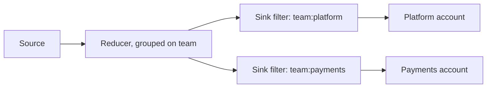

import { Callout } from 'nextra/components'
import { HiddenFAQ } from '@/components/HiddenFAQ'

# Route logs to several vendor accounts

Your logs do not all belong in the same place. Separate teams, environments, or business units each own an account in your observability platform, and a log has to reach the account that owns it. Each account you send to is its own Grepr integration.

This guide routes from a single pipeline: you add a sink for each account and filter each sink to that account's logs. Use it when every account's logs share one configuration. If separate teams need their own pipelines, with different reduction settings, exceptions, or datasets, route each team's logs to its own pipeline instead. See [_](/solution-guides/route-logs-to-separate-pipelines).

## How routing works [#routing]

Routing rests on a _routing key_, which is a field whose value names the account a log belongs to, such as `account` or `team`. Two settings act on it: the reducer groups on the key, and each sink filters on it.

Grouping is what makes the filtering correct. A summary carries the values of the fields it was grouped on, so grouping on the routing key gives every summary exactly one account, and each sink's filter then matches its own account and no other.

<Callout type="warning">
  Configure the grouping before you add the sinks, because leaving it out fails quietly. Without the routing key in the group-by, logs bound for different accounts aggregate together:

  - If the routing key is a tag, the summary carries every value the merged messages had, so every account receives it, with counts that include the other accounts' logs.
  - If the routing key is an attribute, the default merge strategy replaces values that differ with a wildcard, so no filter matches and the summary reaches no account.
</Callout>

## Step 1: Put the routing key on every log [#step1-routing-key]

The routing key has to be on each log before the reducer sees it, holding one value per account. If your collectors already tag logs with the owning team or environment, use that tag. If the value is inside the message, parse it into an attribute or a tag first with the Grok parser or the JSON parser. See [_](/transforms/grok) and [_](/transforms/json-parsing).

A tag and an attribute both work as the routing key. Choose one with a small, fixed set of values, because each value aggregates separately. Decide what happens to logs carrying no value for the key, which match no filter and so reach no account: give them a default value when you parse, or add a sink that catches them.

## Step 2: Group the reducer on the routing key [#step2-group]

1. On the pipeline's **Reducer** step, click **Edit** on the **Fields** card.
1. If the routing key is listed, set its **Behaviour** to **Match or split**.
1. If it is not listed, enter it in the **Add field** row, set the **Behaviour** to **Match or split**, and click **Add**. Enter a tag key as is, and prefix an attribute path with `@`.
1. Click **Save**.

The **Match or split** behavior keeps a field out of aggregation, so messages whose values differ are never merged into one pattern. An attribute is merged as well as grouped, and the default merge strategy keeps the value that every message in the group agrees on. If you set a different merge strategy for the routing attribute, check that it preserves that value rather than combining or discarding it. See [_](/transforms/reducer/configuration#attribute-configuration).

## Step 3: Create a Grepr integration for each account [#step3-integrations]

Create one Grepr integration for each account you send to. An integration authenticates to a single account, so its credential is what decides where its logs land. Name each integration after its account, because that name is what you select when you add the sink. See [_](/integrations).

## Step 4: Add a filtered sink for each account [#step4-sinks]

Repeat for each account:

1. On the pipeline's **Sinks** step, click **Add sink**.
1. In the **Sink** menu, select the integration for the account. Grepr fills in a **Name**, which you can change.
1. In the **Query language** menu, select the syntax you want to write the filter in.
1. In the **Filter Query** field, enter a query that matches only that account's logs, such as `team:platform`.
1. Click **Add**, then save the pipeline.

A sink with an empty filter forwards everything, so give each sink a filter query that matches it to one account. A sink's card reports its filter and shows **All messages** when it has none, which is how you spot one you missed. The filter runs on everything the reducer emits, so summaries, samples, passthrough messages, and exceptions all follow the same routing. To learn about the filter syntax, see [_](/queries/datadog) and [_](/queries/new-relic).

<HiddenFAQ faqs={[
  {
    q: "Can one Grepr pipeline send logs to several accounts of the same vendor?",
    a: "Yes. Add one sink for each account, each pointing at that account's integration, and give each sink a filter that matches only that account's logs. Group the reducer on the same routing key the filters use, so that each summary belongs to exactly one account."
  },
  {
    q: "Why does the reducer need to group on the routing key?",
    a: "Without it, logs for different accounts aggregate together and the summary no longer identifies one account. If the key is a tag, the summary carries every value the merged messages had, so each account's filter matches it and every account receives counts that include the other accounts' logs. If the key is an attribute, the default merge strategy replaces the differing values with a wildcard, so no filter matches and the summary reaches no account."
  },
  {
    q: "Should I create a pipeline for each account or filter the sinks of one pipeline?",
    a: "Create a pipeline for each group, fed by a routing pipeline through Grepr pipes, when the groups need different reduction settings, exceptions, or datasets. Filter the sinks of one pipeline when the groups share one configuration, because you run one pipeline instead of one for each group plus a routing pipeline."
  },
  {
    q: "What happens to logs that have no value for the routing key?",
    a: "They match no sink's filter and reach no vendor account. Give them a default value when you parse the routing key, or add a sink whose filter matches them so they land somewhere you can see."
  },
  {
    q: "Does a sink filter apply to summarized logs as well as raw ones?",
    a: "Yes. The filter runs on everything the reducer emits, so summaries, samples, passthrough messages, and exceptions all follow the same routing."
  }
]} />
